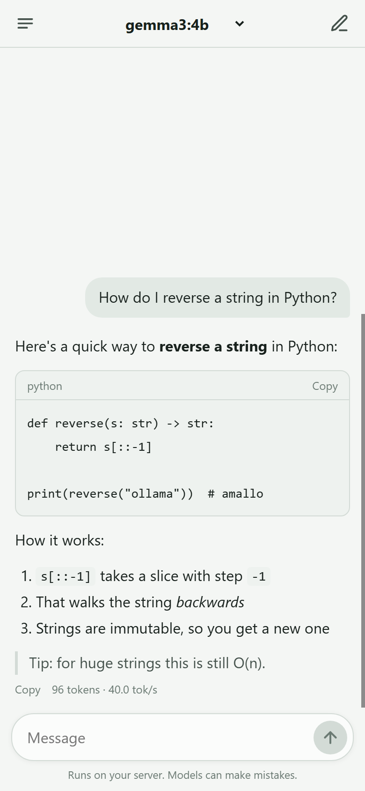

# ollamawg

Reach your Ollama server from your laptop and phone without exposing it to the internet.

`ollamawg` puts a WireGuard tunnel in front of Ollama and adds per-device access control. It gives you a dashboard on the host that shows who is connected, what they run, and who is knocking on the port, and a ChatGPT-style chat page for phones. You can block a device or an IP with one click.

It is a single Go binary. WireGuard runs in user space through [wireguard-go](https://git.zx2c4.com/wireguard-go) and gVisor's network stack, so the server needs no root, no kernel module and no TUN device. Computers connect with `ollamawg connect`, which needs no admin rights either. Phones use the official WireGuard app, because the keys and protocol are standard WireGuard.

**Website:** https://himanshu-mamgain.github.io/ollamawg/

> [!IMPORTANT]
> **ollamawg has not had an independent security audit.** Treat it as an evolving security tool, not an independently verified security product. The cryptography comes from wireguard-go and gVisor, which are widely deployed. ollamawg's own policy, proxy and dashboard code is small and covered by end-to-end tests, but nobody outside the project has reviewed it. Read the [Security model](docs/security.md) before you rely on it, and report problems as described there.


<sub>Screenshot taken with simulated devices and traffic.</sub>

## How it works

```
 devices                                        machine running Ollama
┌──────────────────────────┐                ┌────────────────────────────────────────────────┐
│ laptop                   │   UDP 51820    │                                                │
│ app → 127.0.0.1:11434    │   WireGuard    │ firewall → WireGuard → proxy → 127.0.0.1:11434 │
│        ollamawg connect ─┼──(encrypted)──►│ (IP rules)  (keys)    (roles,   Ollama          │
├──────────────────────────┤                │                        models,                  │
│ phone                    │                │                        rate,                    │
│ browser → 10.77.0.1/chat │                │                        log,                     │
│        WireGuard app    ─┼──(encrypted)──►│                        /chat)                   │
└──────────────────────────┘                │ dashboard on 127.0.0.1:8088                     │
                                            └────────────────────────────────────────────────┘
```

1. **Firewall.** Every UDP packet hitting the WireGuard port is checked against your IP and CIDR rules before WireGuard sees it. Every source is counted, including scanners that never complete a handshake.
2. **WireGuard.** Only devices whose public key you registered can complete a handshake. Each device gets one tunnel IP, and WireGuard guarantees that traffic from that IP really comes from that key.
3. **Proxy.** Inside the tunnel, a reverse proxy enforces each device's role, model allowlist and rate limit. It logs every request with its token counts, then streams the request to Ollama on loopback. It also serves the chat page at `/chat`.

Ollama itself stays on `127.0.0.1`. Nothing outside the tunnel can talk to it.

## Requirements

- **[Ollama](https://ollama.com/download)** on the server, listening on `127.0.0.1:11434`, which is its default. Pull at least one model, for example `ollama pull llama3.2`.
- **A UDP port that devices can reach.** By default this is 51820.
  - At home, forward UDP 51820 on your router to the server.
  - On a cloud VM, open it in the security group.
- **Behind CGNAT? Use a relay.** Many home and mobile ISPs put customers behind carrier-grade NAT, where the router's WAN address is private (`10.x`, `100.64.x`) and no port can be forwarded. Run `ollamawg relay` on any machine with a public IP, for example a free or $5 cloud VM. Your server dials out to it, and devices connect from anywhere, with no port forwarding. The relay only forwards encrypted packets it can't read. See [Relay](docs/relay.md).

## Install

No npm or Go needed: these scripts download the binary for your platform from [GitHub Releases](https://github.com/himanshu-mamgain/ollamawg/releases), check it against the release's `SHA256SUMS`, and install it without admin rights.

```powershell
# Windows (PowerShell): installs to %LOCALAPPDATA%\Programs\ollamawg and adds it to PATH
irm https://himanshu-mamgain.github.io/ollamawg/install.ps1 | iex
```

```sh
# macOS, Linux, FreeBSD: installs to /usr/local/bin if writable, else ~/.local/bin (never uses sudo)
curl -fsSL https://himanshu-mamgain.github.io/ollamawg/install.sh | sh
```

You can read the scripts first: [install.ps1](site/install.ps1), [install.sh](site/install.sh). Set `OLLAMAWG_VERSION=0.4.0` to pin a version, or `OLLAMAWG_INSTALL_DIR` to choose where it goes.

Or use a package manager:

```sh
npm install -g @ollamawg/cli        # prebuilt binary for Linux, macOS, Windows and FreeBSD
npx @ollamawg/cli version           # or run it without installing
go install github.com/himanshu-mamgain/ollamawg/cmd/ollamawg@latest
```

You can also download a binary from any [GitHub Release](https://github.com/himanshu-mamgain/ollamawg/releases) yourself. A `Dockerfile` is included; see [Running as a service](docs/deploy.md#docker).

## Quickstart

On the machine running Ollama:

```sh
ollamawg init --endpoint your-public-ip-or-dns:51820
ollamawg serve
```

`init` writes `server.yaml` and prints the dashboard password. Open `http://127.0.0.1:8088` on the server, or reach it over SSH with `ssh -L 8088:127.0.0.1:8088 server`.

On Windows, `init` also lets devices through Windows Firewall: click **Yes** when Windows asks for permission. If you skip it or pass `--no-firewall`, run `ollamawg firewall` later.

### Add a laptop

```sh
ollamawg add-peer --name laptop        # writes laptop.yaml
```

Copy `laptop.yaml` to the laptop, then run:

```sh
ollamawg connect --config laptop.yaml
curl http://127.0.0.1:11434/api/tags      # any Ollama client works unchanged
```

The ollama CLI, Open WebUI, LangChain, Continue and any OpenAI-compatible client pointed at `http://127.0.0.1:11434/v1` go through the tunnel. The chat page is at `http://127.0.0.1:11434/chat`.

### Add a phone

```sh
ollamawg add-peer --name phone --qr    # prints a QR code
```

You can also use **Add device** in the dashboard, then **Phone**.

1. In the official WireGuard app ([iOS](https://apps.apple.com/app/wireguard/id1441195209), [Android](https://play.google.com/store/apps/details?id=com.wireguard.android)), tap **+ → Create from QR code** and scan it.
2. Turn the tunnel on and open **`http://10.77.0.1:11434/chat`**.
3. Use **Share → Add to Home Screen** to open it like an app.

Ollama apps such as Enchanted or Reins work too: point them at `http://10.77.0.1:11434`.

**Missed the QR code, lost a config, or got a new phone?** The server never stores device private keys, so a config can't be shown twice. Issue a new one instead: `ollamawg reissue --name phone --qr`, or **New config** on the device in the dashboard. The device keeps its name, address and policy, and the old config stops working.



<sub>Chat page on a phone, with a simulated model reply.</sub>

See [Getting started](docs/getting-started.md) for the full walkthrough.

## Dashboard login

The dashboard runs on the server at `http://127.0.0.1:8088`. The browser asks for a username and password.

**Username and password.** `init` creates the user `admin` with a random password, which it prints and saves in `server.yaml` under `admin.password`. To choose your own:

```sh
ollamawg passwd                    # asks for a new password twice
ollamawg passwd --user himanshu    # also change the username
ollamawg init --endpoint ... --user himanshu --set-password    # or choose both at setup
```

Passwords you choose are stored as a bcrypt hash (`admin.password_hash`), never in plain text. A running server picks up the change within 2 seconds.

**Two-factor login (2FA).** This adds a 6-digit code from an authenticator app, such as Google Authenticator, Authy, 1Password or Microsoft Authenticator.

```sh
ollamawg 2fa enable     # shows a QR code: scan it, then type the code to confirm
ollamawg 2fa status
ollamawg 2fa disable    # also the way back in if you lose your phone
```

You can also turn it on from the **2FA** button in the dashboard.

With 2FA on:
- The dashboard opens on a login form that asks for the username, password and code.
- Scripts and Prometheus use the API token (`admin.api_token`) as `Authorization: Bearer <token>`.

See [Dashboard and admin API](docs/dashboard.md).

## Features

- **Userspace WireGuard** on Linux, macOS, Windows and the BSDs, with no admin rights needed on the server or on computers.
- **Works behind CGNAT.** With `ollamawg relay` on any machine with a public IP, devices connect from anywhere, and the server only dials out. The relay forwards ciphertext it can't read.
- **Phones.** Any device with the official WireGuard app connects by scanning a QR code. Only the server's tunnel address is routed through it, so the phone's other traffic is unaffected.
- **Chat page.** A built-in, mobile-friendly chat interface at `/chat`, served inside the tunnel.
  - Streaming replies, Markdown and code blocks, and a model picker limited to what the device is allowed to use.
  - Chat history kept on the device, and Add to Home Screen.
  - It has no separate login: the device's WireGuard key is its identity, and its policy applies.
- **Per-device policy:**
  - Roles: `user` for inference, `readonly`, `admin` for pull and delete, or custom path rules.
  - A model allowlist, such as `llama3.2,qwen3:*`.
  - A requests-per-minute limit.
- **Blocking:**
  - **By device ID.** The session is cut immediately and new handshakes are refused.
  - **By IP or CIDR.** Packets are dropped before WireGuard.
  - **Default-deny mode,** which admits only allowlisted networks.
- **Observability:**
  - Access log with device, public IP, model, status, latency and prompt/generated token counts. It can also be written to a JSON Lines file.
  - Security events: connects, roaming, policy denials, firewall drops, logins and admin actions.
  - Traffic graphs per device for 1, 6 or 24 hours, plus token usage per model.
  - Prometheus `/metrics`.
- **Dashboard:** add devices (as a config file or a phone QR code), edit policy, block and unblock, and manage firewall rules. It is one embedded page with no CDN, so it works offline.
- **Two-factor login.** Optionally protect the dashboard with an authenticator app, such as Google Authenticator, Authy or 1Password. Turn it on from the dashboard or with `ollamawg 2fa enable`. Scripts and Prometheus then use an API token.
- **Hot reload.** `add-peer`, `block` or a hand edit of `server.yaml` applies within 2 seconds without dropping sessions.
- **Safety checks.** The server warns if Ollama is also reachable outside the tunnel or if the config file is world-readable. Configs are written with mode 0600.
- **Go library.** You can embed the server, or call Ollama from Go code through the tunnel without opening a local port.

## Commands

```
Server
  init         create server.yaml with keys and a dashboard password
  add-peer     register a device; --qr prints a QR code for the WireGuard app
  reissue      new key and config (or --qr) for an existing device
  remove-peer  delete a device
  list-peers   show devices and rules
  block        block --device or --ip
  unblock      undo a block
  serve        run the tunnel, proxy, chat page and dashboard
  passwd       set your own dashboard username and password
  2fa          enable, disable or check two-factor dashboard login
  firewall     let devices through the Windows Firewall (one permission prompt)
  relay        run a relay, or point the server at one, for servers behind CGNAT

Client
  connect      bring the tunnel up and expose Ollama on 127.0.0.1:11434
  status       check the handshake and this device's policy

Other
  keygen       print a WireGuard key pair
  version      print the version
```

Run `ollamawg <command> -h` for a command's flags.

## Documentation

| Guide | What's in it |
|---|---|
| [Getting started](docs/getting-started.md) | Install, set up a server, add laptops and phones, connect |
| [Configuration](docs/configuration.md) | Every field in `server.yaml` and client configs, roles, model rules |
| [Dashboard and admin API](docs/dashboard.md) | The UI, two-factor login, the HTTP API behind it, Prometheus metrics |
| [Security model](docs/security.md) | What is protected, how, and what is not |
| [Running as a service](docs/deploy.md) | systemd, launchd, Windows, Docker, port forwarding |
| [Relay](docs/relay.md) | Connect from anywhere when the server is behind CGNAT |
| [Go library](docs/library.md) | Embedding the server and client in your own programs |

## Limitations

- **Behind CGNAT, devices need a relay** on a machine with a public IP. See [Relay](docs/relay.md). The relay serves one server, and all traffic takes the detour through it.
- **The dashboard has one admin account.** Put a reverse proxy with SSO in front if several people manage it.
- **Chat history lives in each device's browser.** It is not synced between devices or stored on the server.
- **No independent security audit yet.** Treat ollamawg as an evolving security tool, not an independently verified security product. The cryptography comes from wireguard-go and gVisor; the policy layer is small and covered by end-to-end tests. See the [Security model](docs/security.md).

## Building from source

```sh
git clone https://github.com/himanshu-mamgain/ollamawg && cd ollamawg
go test -race ./...
go build -o ollamawg ./cmd/ollamawg
```

Go 1.24 or newer is required. Cross-compiling works out of the box, for example `GOOS=windows GOARCH=amd64 go build ./cmd/ollamawg`.

## Releasing

Releases are cut from `main` by [`.github/workflows/publish.yml`](.github/workflows/publish.yml):

1. In a PR, bump `version` (and its `optionalDependencies`) in `npm/cli/package.json` and `Version` in `server.go`. A test fails if they differ.
2. Merge the PR. The workflow publishes every npm package that's missing that version, using trusted publishing with provenance, then creates the GitHub Release with binaries.

A re-run finishes a release that stopped halfway.

## License

[MIT](LICENSE)
