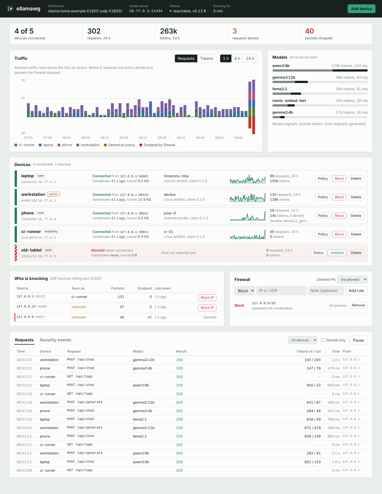

# ollamawg

Reach your Ollama server from anywhere without exposing it to the internet.

`ollamawg` puts a WireGuard tunnel in front of Ollama, adds per-device access control, and gives you a dashboard on the host that shows who is connected, what they run, and who is knocking on the port. You can block a device or an IP with one click.

It is a single Go binary. WireGuard runs in user space through [wireguard-go](https://git.zx2c4.com/wireguard-go) and gVisor's network stack, so it needs no root, no kernel module and no TUN device, on the server or on clients. Keys are standard WireGuard keys.



<sub>Screenshot taken with simulated devices and traffic.</sub>

## How it works

```
 device                                         machine running Ollama
┌──────────────────────────┐   UDP 51820    ┌────────────────────────────────────────────────┐
│ app → 127.0.0.1:11434    │  WireGuard     │ firewall → WireGuard → proxy → 127.0.0.1:11434 │
│        ollamawg connect ─┼──(encrypted)──►│ (IP rules)  (keys)    (roles,   Ollama          │
└──────────────────────────┘                │                        models,                  │
                                            │                        rate, log)               │
                                            │ dashboard on 127.0.0.1:8088                     │
                                            └────────────────────────────────────────────────┘
```

1. **Firewall.** Every UDP packet hitting the WireGuard port is checked against your IP and CIDR rules before WireGuard sees it. Every source is counted, including scanners that never complete a handshake.
2. **WireGuard.** Only devices whose public key you registered can complete a handshake. Each device gets one tunnel IP, and WireGuard guarantees that traffic from that IP really comes from that key.
3. **Proxy.** Inside the tunnel, a reverse proxy enforces each device's role, model allowlist and rate limit. It logs every request with its token counts, then streams the request to Ollama on loopback.

Ollama itself stays on `127.0.0.1`. Nothing outside the tunnel can talk to it.

## Quickstart

On the machine running Ollama:

```sh
npm install -g ollamawg        # prebuilt binary, or:
go install github.com/himanshu-mamgain/ollamawg/cmd/ollamawg@latest

ollamawg init --endpoint your-public-ip-or-dns:51820
ollamawg add-peer --name laptop
ollamawg serve
```

`init` prints the dashboard password. Open `http://127.0.0.1:8088` on the server, or reach it over SSH with `ssh -L 8088:127.0.0.1:8088 server`. Forward UDP port 51820 on your router or cloud firewall.

Copy `laptop.yaml` to the laptop, then run:

```sh
ollamawg connect --config laptop.yaml
curl http://127.0.0.1:11434/api/tags      # any Ollama client works unchanged
```

See [Getting started](docs/getting-started.md) for the full walkthrough.

## Features

- **Userspace WireGuard** on Linux, macOS, Windows and the BSDs, with no admin rights needed on clients.
- **Per-device policy:**
  - Roles: `user` for inference, `readonly`, `admin` for pull and delete, or custom path rules.
  - A model allowlist, such as `llama3.2,qwen3:*`.
  - A requests-per-minute limit.
- **Blocking:**
  - **By device ID.** The session is cut immediately and new handshakes are refused.
  - **By IP or CIDR.** Packets are dropped before WireGuard.
  - **Default-deny mode,** which admits only allowlisted networks.
- **Observability:**
  - Access log with device, public IP, model, status, latency and prompt/generated token counts. It can also be written to a JSON Lines file.
  - Security events: connects, roaming, policy denials, firewall drops and admin actions.
  - Traffic graphs per device for 1, 6 or 24 hours, plus token usage per model.
  - Prometheus `/metrics`.
- **Dashboard:** add devices and download their config, edit policy, block and unblock, and manage firewall rules. It is one embedded page with no CDN, so it works offline.
- **Hot reload.** `add-peer`, `block` or a hand edit of `server.yaml` applies within 2 seconds without dropping sessions.
- **Safety checks.** The server warns if Ollama is also reachable outside the tunnel or if the config file is world-readable. Configs are written with mode 0600.
- **Go library.** You can embed the server, or call Ollama from Go code through the tunnel without opening a local port.

## Documentation

| Guide | What's in it |
|---|---|
| [Getting started](docs/getting-started.md) | Install, set up a server, add devices, connect |
| [Configuration](docs/configuration.md) | Every field in `server.yaml` and client configs, roles, model rules |
| [Dashboard and admin API](docs/dashboard.md) | The UI, the HTTP API behind it, Prometheus metrics |
| [Security model](docs/security.md) | What is protected, how, and what is not |
| [Running as a service](docs/deploy.md) | systemd, launchd, Windows, Docker, port forwarding |
| [Go library](docs/library.md) | Embedding the server and client in your own programs |

## Commands

```
Server                                   Client
  init         create server.yaml          connect   tunnel + local Ollama port
  add-peer     register a device           status    check handshake and policy
  remove-peer  delete a device
  list-peers   show devices and rules    Other
  block        block --device / --ip       keygen    print a key pair
  unblock      undo a block                version
  serve        run tunnel, proxy, dashboard
```

## Building from source

```sh
git clone https://github.com/himanshu-mamgain/ollamawg && cd ollamawg
go mod tidy          # first time only: records dependency checksums in go.sum
go test -race ./...
go build -o ollamawg ./cmd/ollamawg
```

Go 1.24 or newer is required. Cross-compiling works out of the box, for example `GOOS=windows GOARCH=amd64 go build ./cmd/ollamawg`.

## License

[MIT](LICENSE)
