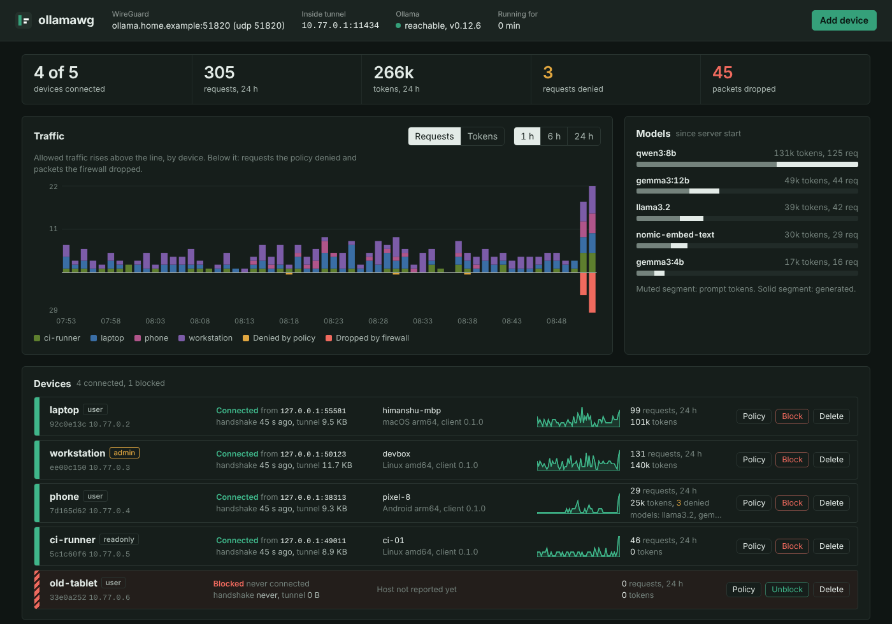

# Dashboard and admin API

`ollamawg serve` starts a dashboard on the server at `http://127.0.0.1:8088`. Log in with the username and password from `init`, `admin` and the generated `admin.password` in `server.yaml`, unless you set your own with `ollamawg passwd`. It refreshes every 3 seconds and works offline, because everything is embedded in the binary.

To open it from another machine without exposing it:

```sh
ssh -L 8088:127.0.0.1:8088 you@server     # then browse http://127.0.0.1:8088
```

## Two-factor login

Press **2FA** in the header, then **Enable 2FA**. Scan the QR code with an authenticator app (Google Authenticator, Authy, 1Password, Microsoft Authenticator, ...) and type the 6-digit code it shows. From then on the dashboard opens on a login form that asks for the password and a current code, and the header gets a **Log out** button.

The same setup works from a terminal on the server, which prints the QR code as text:

```sh
ollamawg 2fa enable      # scan, confirm a code
ollamawg 2fa status
ollamawg 2fa disable     # also the way back in if you lose your phone
```

Turning 2FA on also creates an API token (`admin.api_token` in `server.yaml`, also shown in the 2FA dialog), because scripts and Prometheus can't type codes. See [Admin API](#admin-api).



## What's on the page

**Header.** Shows the WireGuard endpoint and port, the proxy address inside the tunnel, whether Ollama answers (with its version), and uptime.

**Readout.** Shows connected devices, plus requests, tokens, policy denials and firewall drops over the last 24 hours.

**Traffic.** Allowed requests or tokens per device are stacked above the line. Below the line, requests the policy denied are amber and packets the firewall dropped are red. Switch between 1 hour (1-minute bars), 6 hours (5-minute bars) and 24 hours (15-minute bars). Hover a bar for the breakdown.

**Models.** Token usage per model since the server started. The muted part of each bar is prompt tokens and the solid part is generated tokens.

**Devices.** One strip per device. The coloured band shows its state: green when connected, grey when offline, striped red when blocked. Each strip shows the following:

- **Identity:** name, role, device ID and tunnel IP. Hover the ID for the full public key.
- **Connection:** the public IP and port it connects from, the time since its last handshake, and how much traffic has gone through the tunnel.
- **Host:** hostname, OS, architecture and client version, as reported by the client when it connects.
- **Activity:** a sparkline of requests over the last hour, plus requests, tokens and denials over 24 hours.
- **Actions:**
  - **Policy:** change the role, model allowlist and requests per minute.
  - **New config:** gives the device a new key and shows its config and QR code again, for example if the QR code was never scanned or the file was lost. The old config stops working, and the name, address and policy stay.
  - **Block / Unblock:** cuts the session immediately and refuses handshakes. Unblocked devices reconnect within about 15 seconds.
  - **Delete:** removes the key. The device needs a new config to come back.

**Who is knocking.** Every source IP that sent UDP to the WireGuard port. For each one you see the device it belongs to (or *unknown*), packets, drops and when it was last seen. *Unknown* sources are scanners, misconfigured clients, or devices you deleted. **Block IP** adds a firewall rule for that address.

**Firewall.**

- **Unlisted IPs are allowed / are dropped** sets the default policy.
- The form adds block or allow rules for an IP or CIDR.
- Each rule shows how many packets it has matched.

**Requests / Security events.**

- **Requests** is the access log: time, device, method and path, model, result (with the denial reason), tokens in and out, latency and source IP. Filter by device or show denials only.
- **Security events** covers firewall drops (at most one line per source per minute), device connects and disconnects, IP roaming, policy denials, dashboard logins that failed, admin actions, config reloads and upstream health changes.

**Add device.** Creates a device and shows its config once, with Copy and Download buttons. The private key is not kept on the server.

## Admin API

The dashboard is a thin client over a JSON API on the same address. Every endpoint needs authentication: basic auth, or with 2FA on, the API token as a bearer token. `admin.api_token` also works without 2FA once it is set. Requests that change state (`POST`, `PATCH`, `PUT`, `DELETE`) also need the header `X-Ollamawg: 1`.

```sh
A="-u $DASH_USER:$DASH_PASS -H X-Ollamawg:1"                     # without 2FA
A="-H 'Authorization: Bearer $TOKEN' -H X-Ollamawg:1"            # with 2FA
curl -s $A http://127.0.0.1:8088/api/devices | jq
curl -s $A -X POST http://127.0.0.1:8088/api/devices/laptop/block
curl -s $A -X POST http://127.0.0.1:8088/api/firewall -d '{"action":"block","cidr":"203.0.113.0/24","note":"scanner"}'
```

Wherever an endpoint takes `{id}`, you can pass the device name, its device ID, or its base64 public key.

| Method and path | Body / query | Returns |
|---|---|---|
| `GET /api/overview` | | Server facts, device counts, 24-hour totals, packet counters, roles |
| `GET /api/devices` | | List of devices with live stats (see below) |
| `POST /api/devices` | `{"name":"pi","role":"user"}` | `{"name","device_id","address","filename","config"}`, where `config` is the client YAML. This is the only copy. |
| `PATCH /api/devices/{id}` | `{"role":"admin","models":["llama3.2"],"rpm":60}` (all optional) | `{"status":"ok"}` |
| `POST /api/devices/{id}/block` | | `{"status":"ok"}` |
| `POST /api/devices/{id}/unblock` | | `{"status":"ok"}` |
| `POST /api/devices/{id}/reissue` | | A new key for the device; same response as `POST /api/devices`. The old config stops working. |
| `DELETE /api/devices/{id}` | | `{"status":"ok"}` |
| `GET /api/sources` | `?limit=500` | UDP sources: `ip`, `port`, `packets`, `bytes`, `dropped`, `first_seen`, `last_seen`, `device`, `device_id`, `rule`, `blocked` |
| `GET /api/firewall` | | `{"default","rules":[{action,cidr,note,added,hits}],"packets_passed","packets_dropped"}` |
| `POST /api/firewall` | `{"action":"block","cidr":"1.2.3.4","note":""}` | `201` |
| `DELETE /api/firewall` | `?cidr=1.2.3.4/32&action=block` | `{"status":"ok"}` |
| `PUT /api/firewall/default` | `{"default":"deny"}` | `{"status":"ok"}` |
| `GET /api/logs` | `?limit=200&device=<id>&denied=1` | Access entries, newest first |
| `GET /api/events` | `?limit=200&kind=firewall` | Events, newest first. `kind` is one of `firewall`, `device`, `policy`, `admin` or `system`. |
| `GET /api/series` | `?window=1h\|6h\|24h` | `{"step_seconds","times":[...],"devices":{id:[points]},"drops":[...]}` |
| `GET /api/models` | | Per-model `requests`, `prompt_tokens` and `completion_tokens` |
| `GET /metrics` | | Prometheus text format |
| `GET /api/session` | | `{"authenticated","two_factor"}`. Needs no auth. |
| `POST /api/login` | `{"password","code"}` | Sets the session cookie (2FA only). Needs no auth. |
| `POST /api/logout` | | Ends the session |
| `GET /api/2fa` | | `{"enabled","api_token"}` |
| `POST /api/2fa/setup` | | `{"secret","uri","qr_svg"}` for a new authenticator, not yet active |
| `POST /api/2fa/enable` | `{"code"}` | Turns 2FA on with the secret from setup; `{"api_token"}` |
| `POST /api/2fa/disable` | `{"password","code"}` | Turns 2FA off |

A device object looks like this:

```json
{
  "id": "b17c4b14", "name": "laptop", "public_key": "Hq3...=", "address": "10.77.0.2",
  "role": "user", "models": [], "rpm": 0, "blocked": false, "created": "2026-10-25T03:00:00Z",
  "online": true, "endpoint": "203.0.113.5:53975", "last_handshake": "2026-10-25T03:20:11Z",
  "rx_bytes": 9123, "tx_bytes": 48211,
  "client": {"hostname": "himanshu-mbp", "os": "darwin", "arch": "arm64", "version": "0.1.0", "at": "..."},
  "last24h": {"requests": 92, "errors": 0, "denied": 0, "prompt_tokens": 51022, "completion_tokens": 45110, "bytes_out": 803211}
}
```

Errors come back as `{"error": "message"}` with a 4xx status.

## Prometheus

```yaml
scrape_configs:
  - job_name: ollamawg
    static_configs: [{targets: ["127.0.0.1:8088"]}]
    basic_auth: {username: admin, password_file: /etc/prometheus/ollamawg.pass}   # your admin.user
    # with 2FA on, use the API token instead of basic_auth:
    # authorization: {credentials_file: /etc/prometheus/ollamawg.token}
```

| Metric | Type | Labels |
|---|---|---|
| `ollamawg_up` | gauge | none (Ollama reachable) |
| `ollamawg_device_online` | gauge | `device`, `device_id` |
| `ollamawg_device_blocked` | gauge | `device`, `device_id` |
| `ollamawg_device_tunnel_bytes_total` | counter | `device`, `device_id`, `direction` |
| `ollamawg_device_last_handshake_seconds` | gauge | `device`, `device_id` |
| `ollamawg_requests_total` | counter | `device`, `device_id`, `status` |
| `ollamawg_denied_total` | counter | `device`, `device_id` |
| `ollamawg_tokens_total` | counter | `device`, `device_id`, `kind` (prompt or completion) |
| `ollamawg_model_tokens_total` | counter | `model`, `kind` |
| `ollamawg_firewall_packets_total` | counter | `verdict` (pass or drop) |
| `ollamawg_firewall_rule_hits_total` | counter | `action`, `cidr` |

Some alert rules you could start from:

```yaml
- alert: OllamaDown
  expr: ollamawg_up == 0
  for: 2m
- alert: FirewallDropping
  expr: rate(ollamawg_firewall_packets_total{verdict="drop"}[5m]) > 5
- alert: DeviceHittingPolicy
  expr: increase(ollamawg_denied_total[10m]) > 20
```

## Access log file

With `admin.access_log_file` set, every request is appended as one JSON line. The fields are the same as `/api/logs`:

```json
{"time":"2026-10-25T03:20:14Z","device_id":"b17c4b14","device":"laptop","tunnel_ip":"10.77.0.2","remote_ip":"203.0.113.5","method":"POST","path":"/api/chat","model":"llama3.2","status":200,"duration_ms":812,"bytes_out":2210,"prompt_tokens":41,"completion_tokens":88}
```

Ship it to Loki, Elasticsearch or similar with any log agent. ollamawg never rotates the file. With logrotate, use `copytruncate`.

Counters and graphs live in memory and restart from zero when the server restarts. Use `/metrics` or the access log file if you need history beyond that.
